# Veilix feature gallery

These captures use the English interface and sample data. Click any screenshot to open it at full size.

## Compact island

Track, artwork, clock, Bluetooth battery ring, current weather, and date in one row.

[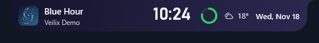](screenshots/01-compact.png)

## Playback and device controls

<table>
  <tr>
    <td width="50%" valign="top"><strong>Now Playing</strong> Track artwork, playback position, seek, and transport controls. <a href="screenshots/02-now-playing.png">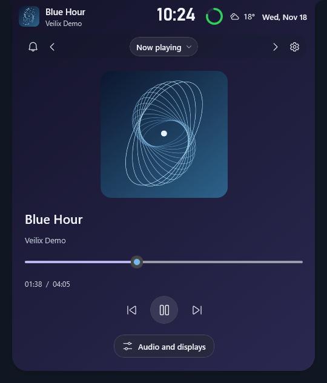</a></td>
    <td width="50%" valign="top"><strong>Audio and displays</strong> System volume and brightness controls for two example displays. <a href="screenshots/03-quick-controls.png">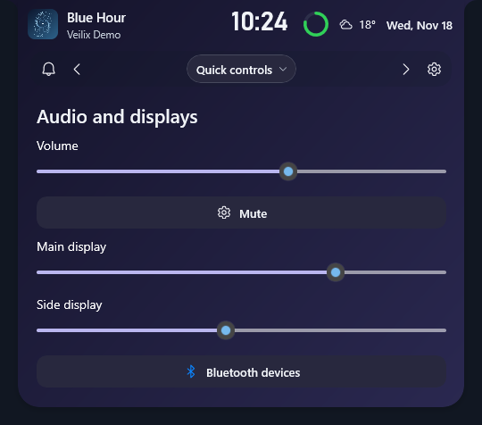</a></td>
  </tr>
</table>

<table>
  <tr>
    <td width="50%" valign="top"><strong>Bluetooth devices</strong> Paired devices, connection controls, and a reported battery level. <a href="screenshots/04-bluetooth.png">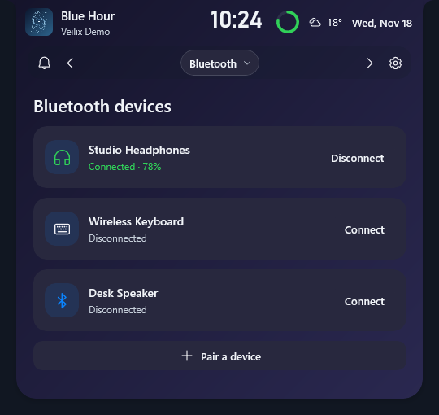</a></td>
    <td width="50%" valign="top"><strong>Weather</strong> Current conditions, hourly temperatures, and sunrise and sunset. <a href="screenshots/05-weather.png">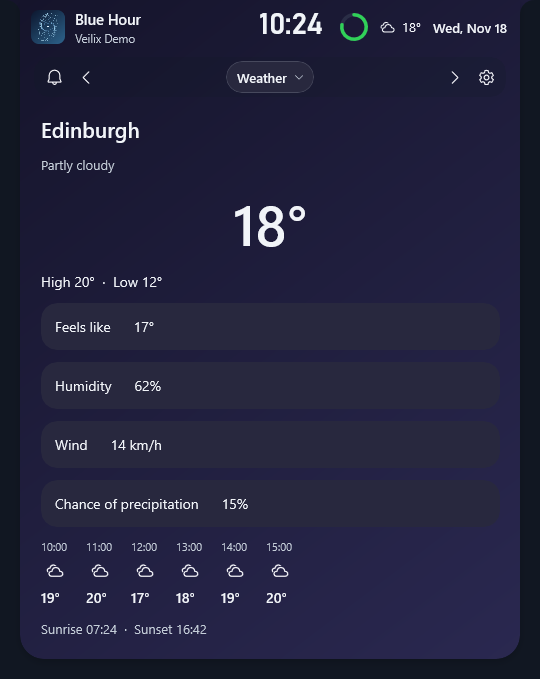</a></td>
  </tr>
</table>

## Timers, tasks, and reminders

<table>
  <tr>
    <td width="50%" valign="top"><strong>Hydration</strong> Daily intake, target, reminder interval, and optional sound. <a href="screenshots/06-hydration.png">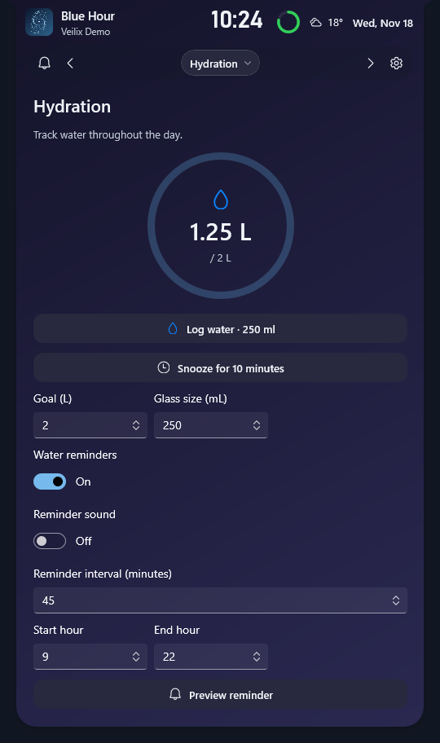</a></td>
    <td width="50%" valign="top"><strong>Pomodoro</strong> Focus and break durations, session count, and timer sound. <a href="screenshots/07-pomodoro.png">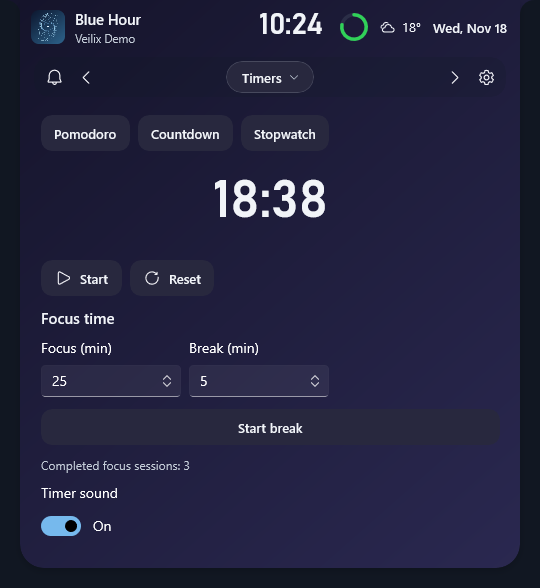</a></td>
  </tr>
</table>

<table>
  <tr>
    <td width="50%" valign="top"><strong>Countdown</strong> A configurable countdown timer with pause and reset. <a href="screenshots/08-countdown.png">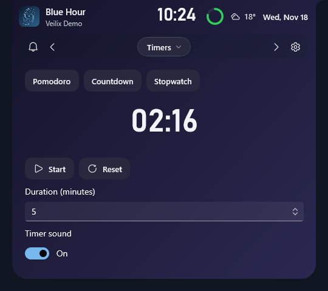</a></td>
    <td width="50%" valign="top"><strong>Stopwatch</strong> Elapsed time and recorded laps. <a href="screenshots/09-stopwatch.png">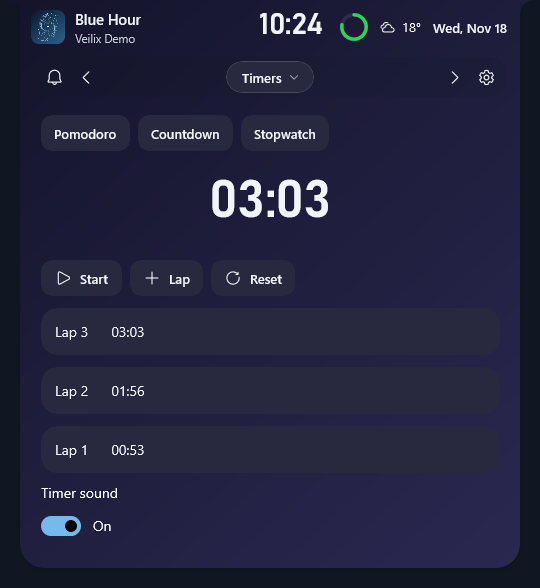</a></td>
  </tr>
</table>

<table>
  <tr>
    <td width="50%" valign="top"><strong>Tasks</strong> Task entry, due times, and filters. <a href="screenshots/10-tasks.png">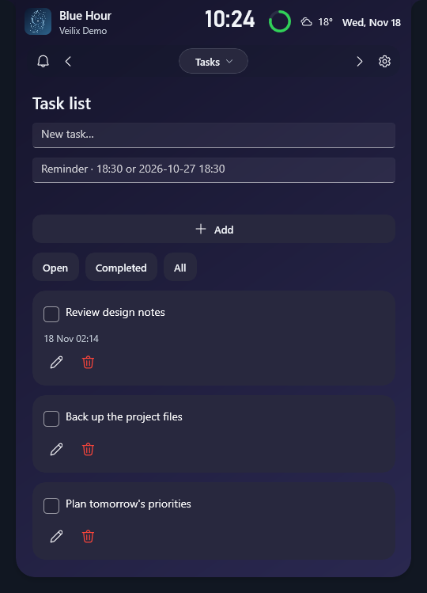</a></td>
    <td width="50%" valign="top"><strong>Notifications</strong> Recent task, focus, and hydration reminders. <a href="screenshots/13-notifications.png">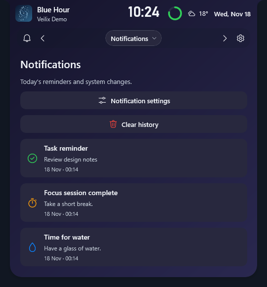</a></td>
  </tr>
</table>

## Files and clipboard

<table>
  <tr>
    <td width="50%" valign="top"><strong>File shelf</strong> Dropped files and folders with access to the local shelf folder. <a href="screenshots/11-file-shelf.png">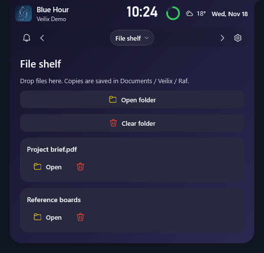</a></td>
    <td width="50%" valign="top"><strong>Clipboard</strong> Saved text and a switch for local history. <a href="screenshots/12-clipboard.png">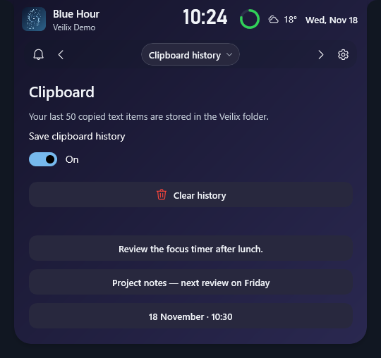</a></td>
  </tr>
</table>

## Appearance and placement

<table>
  <tr>
    <td width="50%" valign="top"><strong>Theme gallery</strong> Preset palettes in the Light filter. <a href="screenshots/14-themes.png">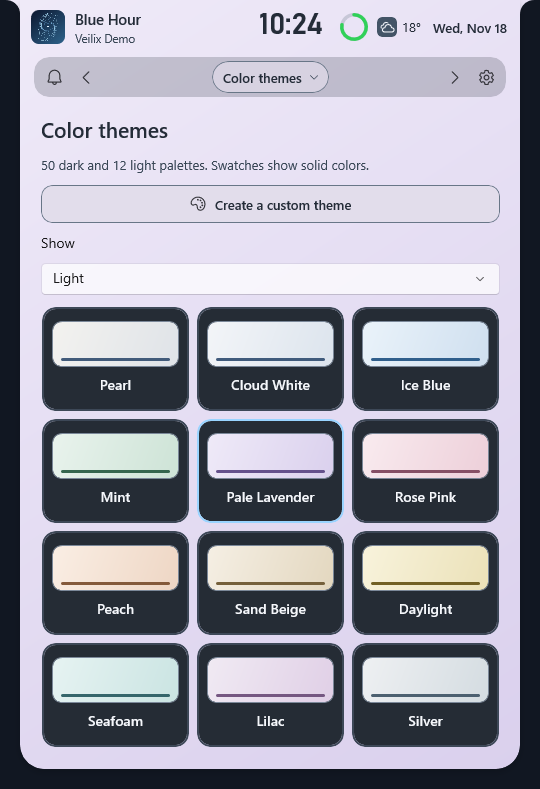</a></td>
    <td width="50%" valign="top"><strong>Custom gradients</strong> Color stops, gradient position, and accent color. <a href="screenshots/15-custom-theme.png">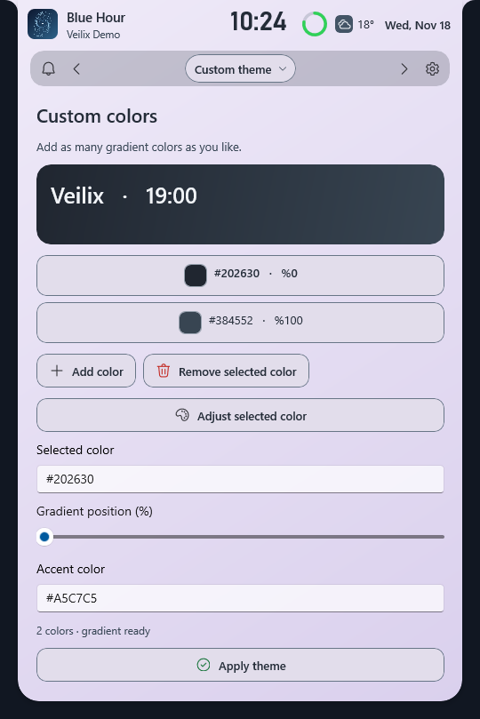</a></td>
  </tr>
</table>

<table>
  <tr>
    <td width="50%" valign="top"><strong>Appearance settings</strong> Surface material, transparency, clock, motion, and animation frame limit. <a href="screenshots/17-appearance.png">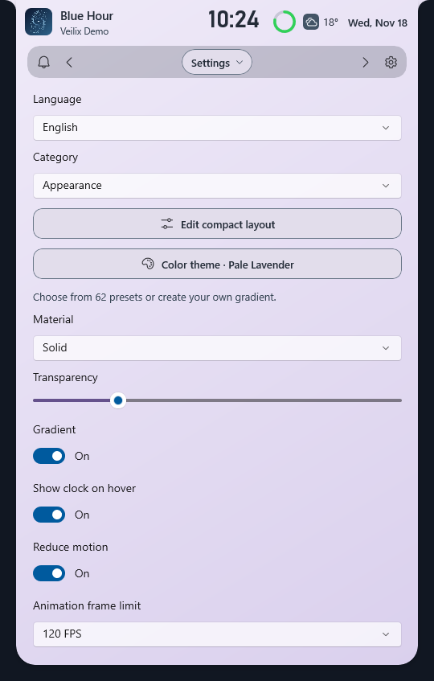</a></td>
    <td width="50%" valign="top"><strong>Compact layout</strong> Drag-to-reorder slots for the compact island. <a href="screenshots/16-compact-layout.png">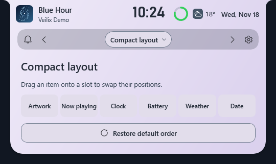</a></td>
  </tr>
</table>

<table>
  <tr>
    <td width="50%" valign="top"><strong>Display settings</strong> Display selection, panel scale, and English language selection. <a href="screenshots/18-display-settings.png">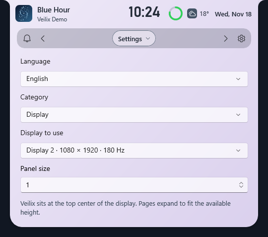</a></td>
    <td width="50%" valign="top"><strong>System settings</strong> Overlap behavior, full-screen hiding, and Windows startup. <a href="screenshots/19-system-settings.png">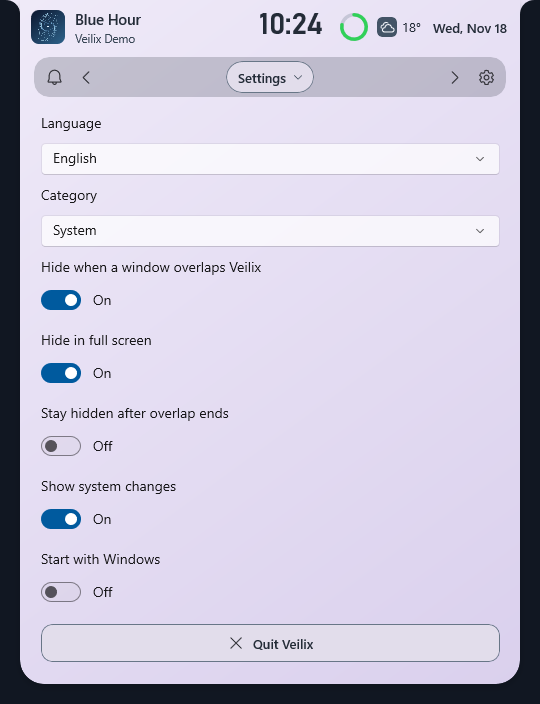</a></td>
  </tr>
</table>

