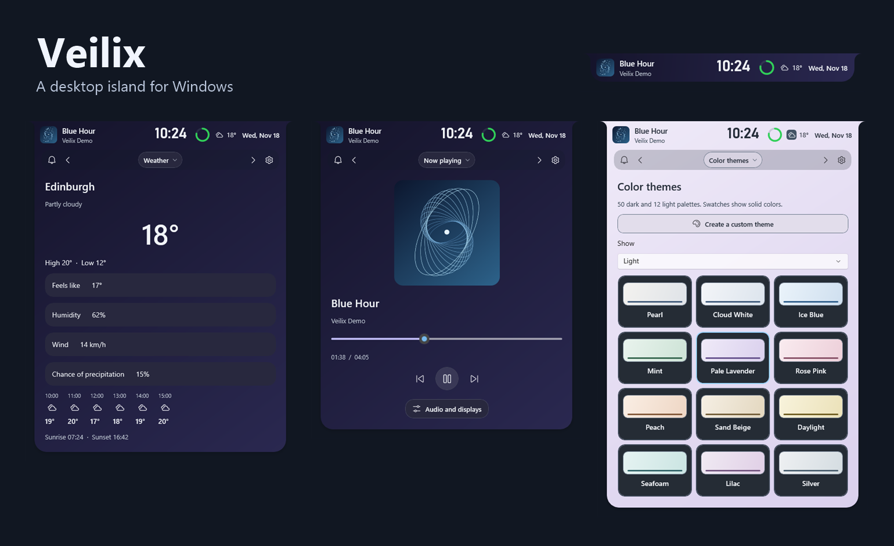

# Veilix



Veilix is a desktop island built with WinUI 3. It sits at the top of the display you choose and opens into a panel for playback, device controls, and everyday tools.

[Download for Windows](../../releases) · [Installation guide](INSTALL.md) · [Feature gallery](FEATURE-GALLERY.md)

## Features

| Area | What you can do |
| --- | --- |
| Media | See track artwork, title, artist, and playback position. Play, pause, skip, or seek when the source supports it. Veilix shows Spotify by default. Enable other apps in Media settings. |
| Quick controls | Adjust system volume and the brightness of supported displays. |
| Bluetooth | See paired devices and battery levels when Windows reports them. Connect or disconnect supported devices from the panel. |
| Weather | Pick a location and check the current temperature, feels-like temperature, humidity, wind, precipitation chances, upcoming hours, and sunrise and sunset. |
| Focus and reminders | Run a Pomodoro, countdown, or stopwatch. Add tasks and set reminders. Track water intake and schedule hydration reminders with an optional sound. |
| Files and clipboard | Drop files into the shelf to save copies. Reuse copied text from local clipboard history and turn history off in the Clipboard section. |
| Notifications | See recent Veilix reminders and enabled Windows status changes. Notification history is cleared daily. |
| Appearance and placement | Choose from 62 palettes or build a custom gradient. Switch between Glass, Mica, Transparent, and Solid. Pick a display, adjust the panel size, and rearrange the compact layout. |
| Desktop behavior | Open sections by clicking the title, using the arrows, or scrolling over the navigation bar. Hide the panel when windows overlap it or enter full screen. Reveal it from the edge handle. Use Reduce Motion or start Veilix with Windows. |

The interface is available in English and Turkish. All screenshots use sample data.

## Requirements

- Windows 10 version 2004 or later, or Windows 11, on x64.
- [.NET 10 Desktop Runtime for Windows x64](https://dotnet.microsoft.com/en-us/download/dotnet/10.0).
- An internet connection for weather search and forecasts.

Download the Windows x64 ZIP from [Releases](../../releases), extract it to a writable folder, and open **Veilix.exe**. For English, open the gear menu and choose **Dil → English**.

## Local data

Settings and enabled clipboard history are stored locally in the app's **data** folder. The file shelf saves copies in **Documents → Veilix → Raf**. Weather search and forecasts use [Open-Meteo](https://open-meteo.com/).

## Build from source

Install the .NET 10 SDK on Windows x64. Run this command from the repository root.

```powershell
./winui/dev.ps1 -Mode Publish
```

The published app is in `dist/Veilix-WinUI`. See the [WinUI development notes](winui/README.md) for testing. The source is distributed under GPL-3.0-or-later. See [LICENSE](LICENSE) and [NOTICE](NOTICE).
